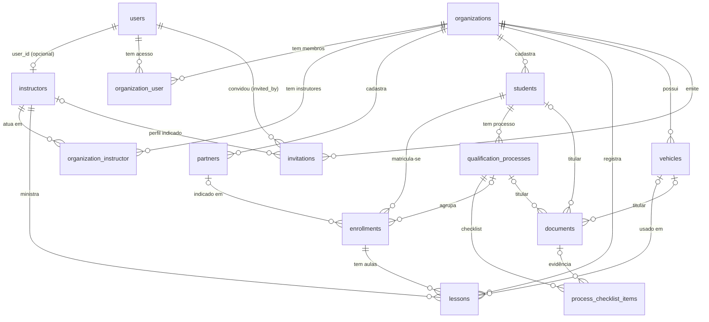

# Modelo de dados

Tabelas, campos relevantes, constraints e relacionamentos. A fonte da verdade são as migrations em `apps/api/database/migrations/`.

> Status: ✅ implementado (16 migrations do domínio + tabelas padrão do Laravel).

## Diagrama

## Tabelas do domínio

### `instructors` — identidade profissional (global)

| Campo | Tipo | Regra |
|---|---|---|
| `id` | bigint PK | |
| `user_id` | bigint, **nullable, unique** | FK `users.id`, `ON DELETE SET NULL`. Nulo = instrutor sem conta. |
| `full_name` | varchar(150) | Obrigatório. |
| `credential_number` | varchar(50), nullable | Número de credencial, quando informado. |
| `categories` | json | Lista de categorias ensinadas (`A`, `AB`, `B`, ...). Pode ser `[]`. |
| `created_at`, `updated_at` | timestamp | |

Não há coluna de organização: o perfil é global.

### `organizations` — espaços de trabalho

| Campo | Tipo | Regra |
|---|---|---|
| `id` | bigint PK | |
| `name` | varchar(150) | Obrigatório. |
| `type` | enum(`cfc`, `independent`) | Imutável após a criação (validado na API). |
| `document` | varchar(20), nullable, **unique** | Somente dígitos (CNPJ/CPF). Vários nulos são permitidos. |
| `email`, `phone` | varchar, nullable | Contato opcional. |
| `timezone` | varchar(64), default `America/Sao_Paulo` | Fuso IANA. Os horários ficam em UTC; o fuso define o "dia" dos filtros de agenda. |
| timestamps | | |

### `organization_user` — vínculo de acesso

| Campo | Tipo | Regra |
|---|---|---|
| `id` | bigint PK | |
| `organization_id` | FK → `organizations`, `RESTRICT` | |
| `user_id` | FK → `users`, `CASCADE` | |
| `role` | enum(`owner`, `admin`, `staff`, `instructor`) | Ver [permissoes.md](permissoes.md). |
| timestamps | | |

**Constraints:** `UNIQUE (organization_id, user_id)` e índice em `user_id`.

Existência da linha = acesso ativo. Revogar acesso apaga a linha.

### `organization_instructor` — vínculo profissional

| Campo | Tipo | Regra |
|---|---|---|
| `id` | bigint PK | |
| `organization_id` | FK → `organizations`, `RESTRICT` | |
| `instructor_id` | FK → `instructors`, `RESTRICT` | |
| `active` | boolean, default `true` | Desativar impede **novas** aulas. Não apaga histórico. |
| timestamps | | |

**Constraints:** `UNIQUE (organization_id, instructor_id)`. Esta chave é alvo de FKs compostas em `lessons` e `invitations`.

### `partners` — CFCs externos

| Campo | Tipo | Regra |
|---|---|---|
| `id` | bigint PK | |
| `organization_id` | FK → `organizations`, `RESTRICT` | Dono do cadastro. |
| `name` | varchar(150) | Obrigatório. |
| `document`, `email`, `phone` | nullable | |
| `deleted_at` | timestamp, nullable | Exclusão lógica (SoftDeletes). |
| timestamps | | |

**Constraints:** `UNIQUE (organization_id, id)`, alvo da FK composta de `enrollments`.

### `students` — alunos

| Campo | Tipo | Regra |
|---|---|---|
| `id` | bigint PK | |
| `organization_id` | FK → `organizations`, `RESTRICT` | |
| `name` | varchar(150) | Obrigatório. |
| `cpf` | char(11), nullable | Somente dígitos. |
| `email`, `phone` | nullable | |
| `birth_date` | date, nullable | |
| `deleted_at` | timestamp, nullable | Exclusão lógica. |
| timestamps | | |

**Constraints:** `UNIQUE (organization_id, cpf)` (vários nulos permitidos) e `UNIQUE (organization_id, id)`.

Dois alunos com o mesmo CPF só conflitam **dentro** da mesma organização. Entre organizações, são registros independentes.

> A unicidade vale também para alunos excluídos logicamente. Para recadastrar um CPF excluído, é preciso restaurá-lo ou tratar o registro antigo.

### `enrollments` — matrículas

| Campo | Tipo | Regra |
|---|---|---|
| `id` | bigint PK | |
| `organization_id` | FK → `organizations`, `RESTRICT` | |
| `student_id` | bigint | FK **composta** `(organization_id, student_id)` → `students(organization_id, id)` |
| `partner_id` | bigint, nullable | FK **composta** `(organization_id, partner_id)` → `partners(organization_id, id)` |
| `qualification_process_id` | bigint, nullable | FK **composta** `(organization_id, qualification_process_id)` → `qualification_processes`. O processo precisa ser do mesmo aluno (validado na API). |
| `category` | varchar(3) | Valores de `LicenseCategory`: `A`, `AB`, `AC`, `AD`, `AE`, `B`, `C`, `D`, `E`, `ACC`. |
| `status` | enum(`prospect`, `contracted`, `in_service`, `closed`, `terminated`) | Default `contracted`. `closed`/`terminated` não aceitam aulas. |
| `contracted_minutes` | int, nullable | Serviço contratado em **minutos** (não presume "hora" nem "hora-aula"). |
| `price_cents` | bigint, nullable | Preço em centavos. |
| `notes` | text, nullable | |
| timestamps | | |

**Constraints:** `UNIQUE (organization_id, id)` (alvo da FK de `lessons`) e índice `(organization_id, student_id)`.

As FKs compostas garantem, no banco, que o aluno e o parceiro pertencem à mesma organização da matrícula. Se `partner_id` for nulo, a FK não é verificada (comportamento padrão do MySQL para FK com coluna nula).

### `lessons` — aulas

| Campo | Tipo | Regra |
|---|---|---|
| `id` | bigint PK | |
| `organization_id` | FK → `organizations`, `RESTRICT` | Organização que registrou a aula. |
| `enrollment_id` | bigint | FK **composta** `(organization_id, enrollment_id)` → `enrollments(organization_id, id)` |
| `instructor_id` | bigint | FK **composta** `(organization_id, instructor_id)` → `organization_instructor(organization_id, instructor_id)` |
| `starts_at`, `ends_at` | datetime | Armazenados em UTC. `ends_at > starts_at` e duração ≤ 240 min (validado na API). |
| `status` | enum(`scheduled`, `completed`, `missed`, `cancelled`) | Default `scheduled`. |
| `vehicle_id` | bigint, nullable | FK **composta** `(organization_id, vehicle_id)` → `vehicles`. |
| `actual_minutes` | smallint, nullable | Duração real, preenchida ao concluir (padrão: a agendada). |
| `status_reason` | varchar(255), nullable | Motivo de falta ou cancelamento. |
| `notes` | text, nullable | |
| `evolution` | text, nullable | Evolução pedagógica (aula realizada). |
| `registry_status` | enum(`not_informed`, `pending`, `confirmed`, `rejected`) | Registro **oficial** da aula, separado do status operacional. |
| `registry_reference` | varchar(100), nullable | Protocolo/referência do lançamento oficial. |
| `registry_document_id` | bigint, nullable | FK **composta** → `documents` (evidência). |
| timestamps | | |

**Índices:**

- `(vehicle_id, status, starts_at)`: conflito de veículo.
- `(instructor_id, status, starts_at)`: consulta de conflito entre organizações.
- `(organization_id, starts_at)`: agenda do espaço.
- `(organization_id, status)`: filtros por status.

A FK composta para `organization_instructor` garante que a aula só é gravada com um instrutor vinculado ao espaço (ativo ou não). Que o vínculo esteja **ativo** é verificado na aplicação.

### `vehicles` — veículos de instrução

| Campo | Tipo | Regra |
|---|---|---|
| `id` | bigint PK | |
| `organization_id` | FK → `organizations`, `RESTRICT` | |
| `plate` | varchar(8) | Maiúsculas, 7 alfanuméricos. `UNIQUE (organization_id, plate)`, inclusive excluídos. |
| `brand`, `model`, `year` | | `model` obrigatório. |
| `category` | varchar(3) | Categoria **simples** (`A`, `B`, `C`, `D`, `E`, `ACC`), validada na API. |
| `adapted`, `adaptations` | boolean, text | Adaptações para PCD. |
| `crlv_expires_at` | date, nullable | Nulo = sem validade informada. |
| `status` | enum(`active`, `inactive`) | |
| `notes` | text, nullable | |
| timestamps, `deleted_at` | | Exclusão lógica. |

**Constraints:** `UNIQUE (organization_id, id)` (alvo das FKs compostas de `lessons` e `documents`).

### `qualification_processes` — processos de habilitação

Acompanhamento **local** de um atendimento. Não é o sistema oficial.

| Campo | Tipo | Regra |
|---|---|---|
| `id` | bigint PK | |
| `organization_id` | FK → `organizations`, `RESTRICT` | |
| `student_id` | bigint | FK **composta** `(organization_id, student_id)` → `students`. Imutável. |
| `type` | enum(`first_license`, `category_addition`, `category_change`, `refresher`) | Imutável (o checklist depende dele). |
| `uf` | char(2) | |
| `municipality`, `renach`, `protocol` | varchar, nullable | Referências oficiais. Renach **não** é único: compartilhar Renach não une alunos. |
| `opened_at` | date, nullable | Data oficial de abertura. |
| `current_categories`, `target_categories` | json | Listas de `LicenseCategory`. Atuais vazias na primeira habilitação. |
| `status` | enum(`preparing`, `active`, `pending`, `awaiting_issuance`, `completed`, `closed`) | Situação do acompanhamento local. |
| `notes` | text, nullable | |
| timestamps | | |

### `process_checklist_items` — checklist de liberação para a prática

| Campo | Tipo | Regra |
|---|---|---|
| `id` | bigint PK | |
| `organization_id` | FK → `organizations` | |
| `qualification_process_id` | bigint | FK **composta** → `qualification_processes`. `UNIQUE (qualification_process_id, type)`. |
| `type` | varchar(40) | `current_license`, `theory_completion`, `learning_license`, `medical_exam`, `psychological_exam`, `toxicological_exam`. |
| `required` | boolean | Não editável pela API. |
| `status` | enum(`unknown`, `pending`, `in_progress`, `done`, `verified`, `not_applicable`, `blocked`) | Só `verified` e `not_applicable` liberam a prática. |
| `source` | enum(`student_declared`, `document`, `official_system`, `imported`), nullable | Origem da informação. |
| `reference`, `notes`, `occurred_on` | | `notes` é o motivo obrigatório para `not_applicable`/`blocked`. |
| `document_id` | bigint, nullable | FK **composta** → `documents`. Anexar não conclui o item. |
| `checked_by`, `checked_at` | FK → `users` (`SET NULL`), timestamp | Quem conferiu e quando. |
| timestamps | | |

### `documents` — documentos privados

| Campo | Tipo | Regra |
|---|---|---|
| `id` | bigint PK | |
| `organization_id` | FK → `organizations` | |
| `type` | varchar(40) | Valores de `DocumentType`. |
| `status` | enum(`attached`, `verified`, `rejected`, `replaced`) | |
| `student_id`, `qualification_process_id`, `vehicle_id` | bigint, nullable | FKs **compostas**. Ao menos um (validado na API). |
| `replaces_document_id`, `version` | bigint nullable, smallint | Histórico de substituição (FK composta para si mesma). |
| `issuer`, `issued_at`, `expires_at` | | `expires_at` nulo = validade indeterminada. |
| `storage_path`, `original_name`, `mime_type`, `size` | | Arquivo em disco **privado**; `storage_path` nunca sai pela API. |
| `uploaded_by`, `verified_by`, `verified_at` | FK → `users` (`SET NULL`) | |
| `notes` | text, nullable | |
| timestamps | | |

### `invitations` — convites

| Campo | Tipo | Regra |
|---|---|---|
| `id` | bigint PK | |
| `organization_id` | FK → `organizations`, `RESTRICT` | |
| `email` | varchar(150) | Normalizado em minúsculas. |
| `role` | enum(`owner`, `admin`, `staff`, `instructor`) | |
| `instructor_id` | bigint, nullable | FK **composta** `(organization_id, instructor_id)` → `organization_instructor`. Só para `role = instructor`. |
| `token_hash` | char(64), **unique** | SHA-256 do token. O token em texto **não** é gravado. |
| `invited_by_user_id` | FK → `users`, `RESTRICT` | |
| `expires_at` | timestamp | Criação + `INVITATION_TTL_DAYS` (padrão 7). |
| `accepted_at`, `accepted_by_user_id` | nullable | Preenchidos no aceite. |
| `revoked_at` | timestamp, nullable | Preenchido na revogação. |
| timestamps | | |

**Índice:** `(organization_id, email)`.

Estado derivado (não persistido): `accepted` > `revoked` > `expired` > `pending`.

## Tabelas padrão do Laravel usadas

| Tabela | Uso |
|---|---|
| `users` | Contas de acesso. Inclui `email_verified_at`. |
| `sessions` | Sessões da SPA (`SESSION_DRIVER=database`). Criada pela migration padrão de `users`. |
| `personal_access_tokens` | Tokens Sanctum do app mobile. |
| `cache`, `cache_locks`, `jobs`, `job_batches`, `failed_jobs`, `password_reset_tokens` | Padrão do framework. Não são usadas pelo domínio. |

## Como as relações se usam no código

| Relação | Onde |
|---|---|
| `Organization::members()` (BelongsToMany `User`) | Route binding de `{member}` e papel do usuário. |
| `Organization::instructors()` (BelongsToMany `Instructor`, pivot `active`) | Route binding de `{instructor}`. |
| `Organization::students()`, `partners()`, `enrollments()`, `lessons()`, `invitations()` | Route binding com `scopeBindings()`. |
| `User::instructor()` (HasOne) | Perfil profissional da conta. |
| `User::organizations()` (BelongsToMany, pivot `role`) | Lista de espaços e agenda pessoal. |

## Exclusão e integridade

| Tabela | Exclusão |
|---|---|
| `organizations` | A API não expõe exclusão. FKs usam `RESTRICT`. |
| `users` | Remove o vínculo de acesso (`CASCADE`) e zera `instructors.user_id` (`SET NULL`). |
| `partners`, `students` | Exclusão lógica. |
| `enrollments`, `lessons`, `invitations`, `instructors` | A API não expõe exclusão. |

Detalhes e justificativas em [arquitetura.md](arquitetura.md#12-exclusão-lógica-e-histórico).
