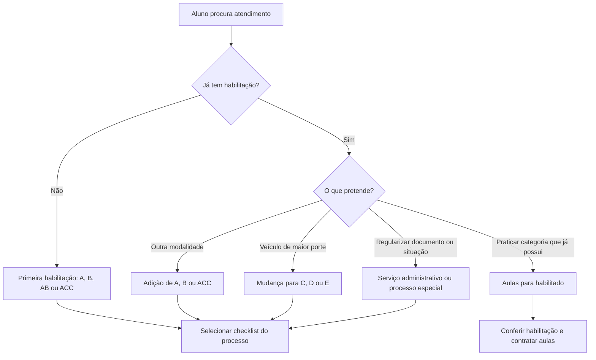
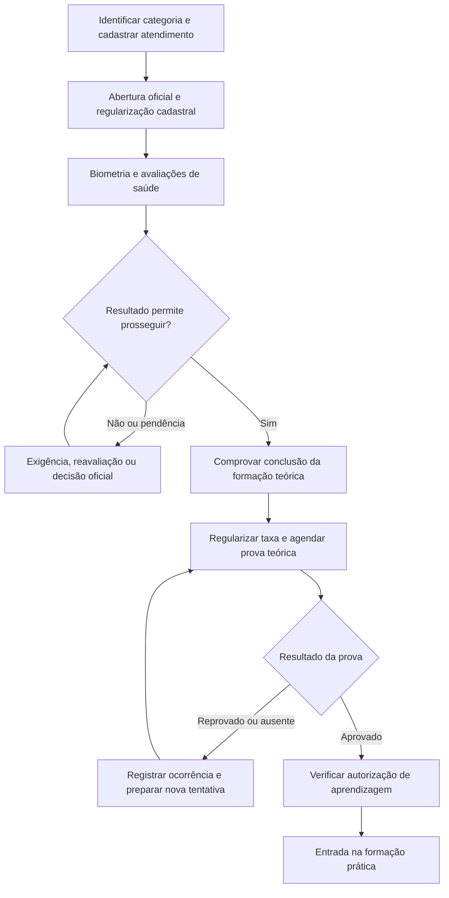
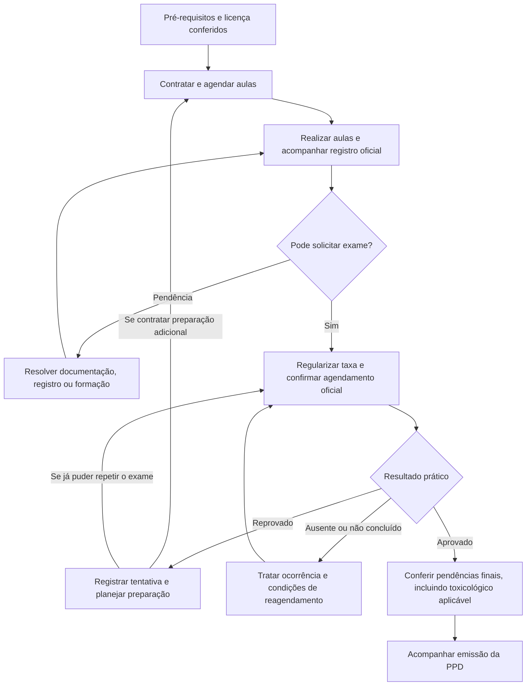
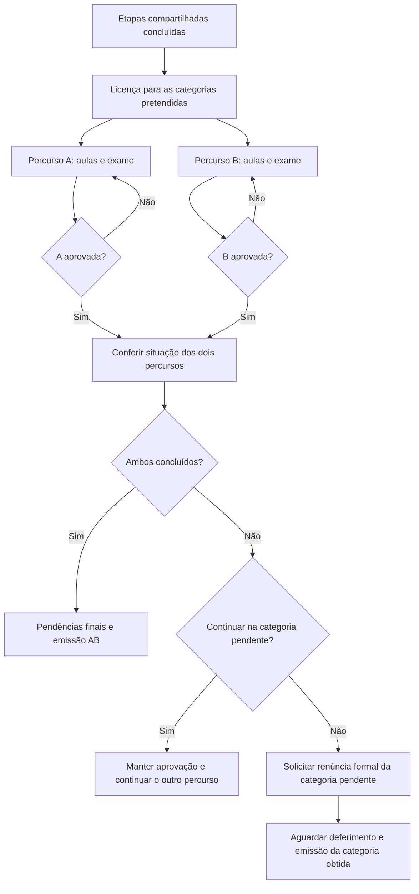
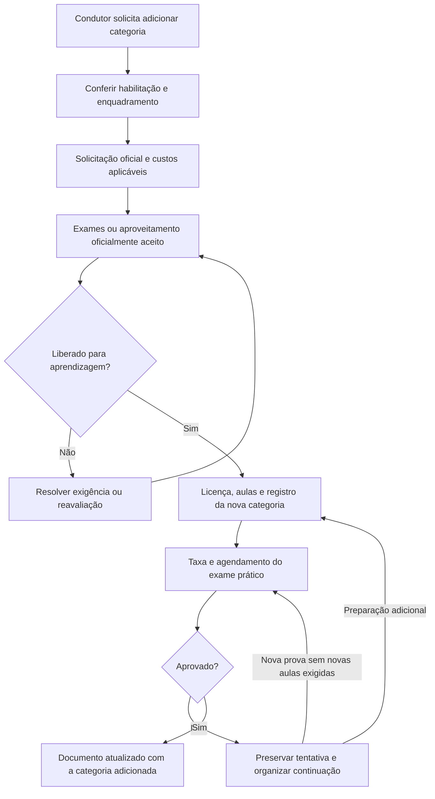
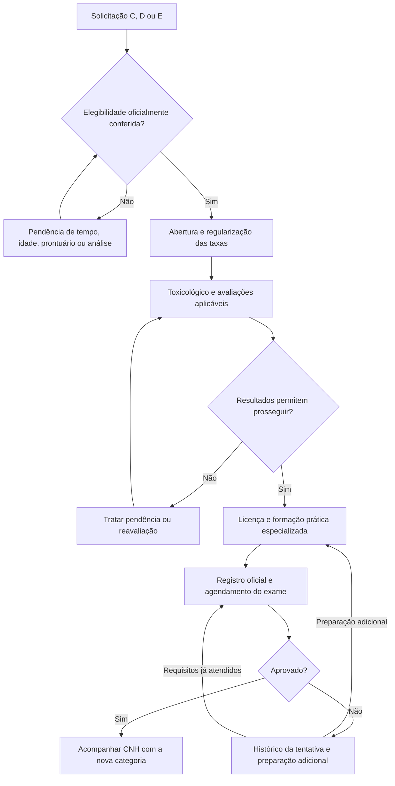
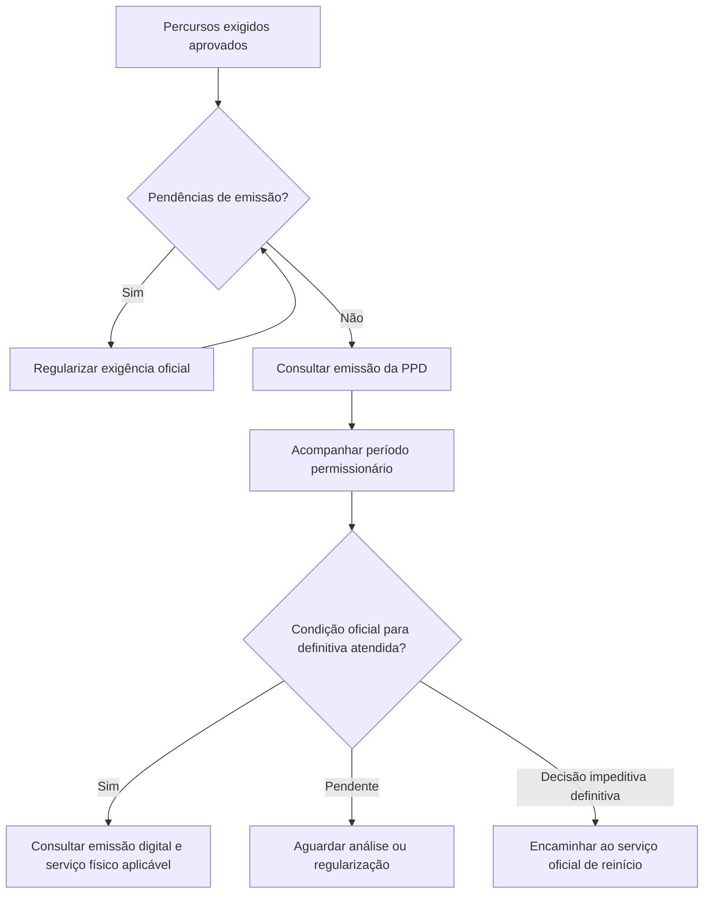
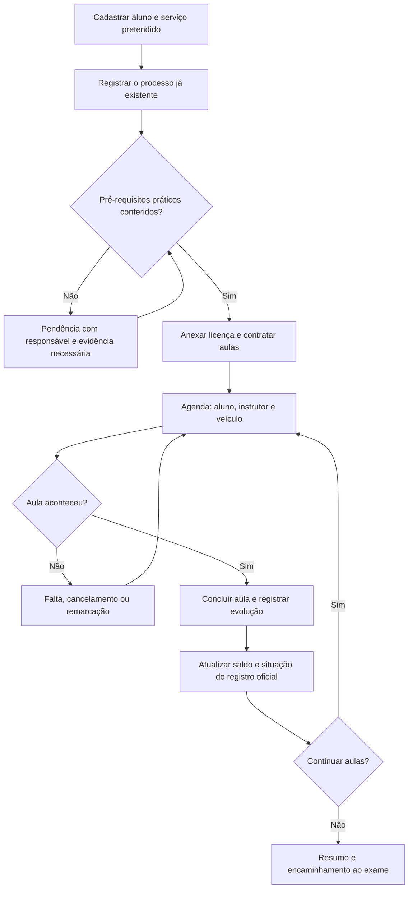

# Fluxos de habilitação e operação de autoescola — Brasil, com foco em MG

**Versão:** 1.0  
**Pesquisa revisada em:** 17/10/2026  
**Destino sugerido:** `docs/fluxo-habilitacao-brasil-mg.md`  
**Finalidade:** referência de domínio para Thiago e para a IA que implementará o sistema.

> **O produto atual começa na formação prática.** Na primeira habilitação, recebe o aluno com aprovação teórica e autorização de aprendizagem verificadas. Na adição ou mudança, recebe o condutor com os pré-requisitos próprios desse serviço atendidos. A gestão integral das etapas anteriores é evolução futura.

> Este documento cobre os principais caminhos A, B, AB, C, D, E e ACC e as exceções operacionais identificadas. Não é uma especificação exaustiva de todos os atos administrativos, decisões judiciais e portarias municipais/estaduais. Pontos não confirmados estão identificados; não devem virar regra automática por dedução da IA.

## 1. Como usar este documento

Para entender o produto agora, leia as seções 2, 3 e 15. Para implementar uma modalidade, consulte seu fluxo e as pendências da seção 19. Fontes oficiais estão na seção 23.

Classificação utilizada:

- **Norma:** requisito encontrado na legislação federal consultada.
- **MG:** procedimento publicado por órgão oficial de Minas Gerais.
- **Produto:** proposta de funcionamento do nosso software, sem pretensão de substituir o sistema oficial.
- **Validar:** divergência ou detalhe cuja aplicação operacional precisa de confirmação antes de automatizar.

Uma página de serviço pode continuar citando norma revogada. A data de atualização da página, sozinha, não prova que todos os seus parágrafos foram revisados. O catálogo federal apresenta a Resolução Contran 1.020/2025 em vigor e a Resolução 789/2020 como revogada. [S01]

## 2. Visão geral: qual atendimento chegou?

O enquadramento deve considerar o histórico real do condutor, e não apenas a categoria desejada. Uma pessoa que quer A pode estar tirando a primeira carteira, adicionando A à B ou apenas retomando a prática de moto.

### Perguntas da recepção

1. Qual serviço quer contratar e qual categoria pretende obter?
2. Já possui CNH, PPD ou ACC? Quais categorias e desde quando?
3. Tem processo em andamento? Em qual UF e município?
4. Qual é a data de abertura oficial? Qual o identificador/Renach disponível?
5. Quais etapas já foram concluídas e como foram comprovadas?
6. Há restrições, adaptações, bloqueios ou exigências oficiais pendentes?
7. Pretende exercer atividade remunerada? Qual atividade?
8. Quem é o prestador contratado, quem dará as aulas e quem paga cada serviço?

**Produto:** registrar respostas mínimas e documentos necessários; não exigir que um aluno entregue todo seu histórico clínico para comprar aulas.

## 3. Três coisas diferentes: processo, contrato e aula

| Conceito | Exemplo | Papel no software |
|---|---|---|
| Processo de habilitação | Primeira habilitação AB em MG | Acompanhar etapas e referências oficiais |
| Contratação/matrícula | Dez aulas de B com o CFC Alfa | Controlar serviço vendido e saldo |
| Aula | B, terça às 10h, instrutor João | Controlar agenda, execução e evidência |

O aluno pode chegar com o processo já iniciado, comprar poucas aulas, mudar de prestador ou contratar preparação extra. Não recriar suas etapas anteriores nem exigir a compra do pacote completo.

No produto, o processo é um acompanhamento local da organização. O Renach não concede acesso automático aos dados mantidos por outro CFC. A troca de prestador, a transferência oficial de UF e a movimentação de documentos entre organizações são operações diferentes.

**Primeira habilitação AB:** mantenha um processo com dois percursos práticos. Etapas compartilhadas não devem ser duplicadas por matrícula. A página de MG informa licença AB e provas práticas distintas, com taxa de direção por categoria. [S04]

## 4. Categorias e caminhos de entrada

### 4.1 O que cada categoria representa

Resumo para triagem, não validador completo de todos os tipos de veículos. [S02]

| Categoria | Referência principal |
|---|---|
| A | Veículos motorizados de duas ou três rodas |
| B | Veículos fora de A, até 3.500 kg de PBT e até oito passageiros, além do motorista |
| C | Abrange B e veículos de carga acima de 3.500 kg |
| D | Abrange B/C e transporte de mais de oito passageiros, além do motorista |
| E | Combinações de veículos enquadradas nos limites do CTB |
| ACC | Autorização específica para ciclomotor; não é autorização geral para motocicleta |

**Produto:** guardar categorias atuais e pretendidas separadamente. AC, AD e AE representam combinações com A, não três cursos inteiramente novos.

### 4.2 Elegibilidade para mudança

| Destino | Referência de ingresso |
|---|---|
| C | Ao menos um ano em B |
| D | 21 anos completos; dois anos em B ou um ano em C |
| E | 21 anos; texto federal refere um ano em C; portal MG também menciona D — verificar caso D→E |

As mudanças exigem avaliação do prontuário; o texto consultado não permite mais de uma gravíssima nos últimos doze meses. Não usar a antiga regra genérica de “nenhuma grave ou gravíssima”. [S02][S07]

**Produto:** a aplicação faz triagem e guarda evidência; o deferimento oficial não é calculado apenas pela idade e data de emissão da CNH atual. Guarde datas de aquisição por categoria quando necessárias.

### 4.3 Matriz de encaminhamento

| Situação atual | Pedido | Encaminhamento |
|---|---|---|
| Nunca habilitado | A | Primeira habilitação A |
| Nunca habilitado | B | Primeira habilitação B |
| Nunca habilitado | A e B | Primeira habilitação AB |
| Nunca habilitado | C, D ou E | Não iniciar diretamente; avaliar percurso a partir de B e requisitos posteriores |
| A | B | Adição B |
| B | A | Adição A |
| C/D/E sem A | A | Adição A; preservar a categoria já possuída |
| B/AB | C | Mudança C, se elegível |
| B/AB | D | Mudança D, se elegível; C intermediária não é sempre necessária |
| C/AC | D ou E | Mudança correspondente, se elegível |
| D/AD | E | Verificação de elegibilidade oficial; ver divergência da seção 19 |
| A apenas | C/D/E | Primeiro obter B e depois cumprir requisitos de mudança |
| ACC | B | Adição B prevista no fluxo de adição |
| ACC apenas | A | Confirmar enquadramento oficial em MG; não presumir conversão automática |
| B/C/D/E | ACC | Adição específica, conforme canal oficial |
| Já possui a categoria | Mais segurança ao dirigir | Aulas para habilitado |
| CNH suspensa ou cassada | Voltar a dirigir | Processo especial, não mera compra de aulas |

Base da classificação: serviços MG e definições federais. A matriz é uma proposta de roteamento; células com confirmação pendente não devem ser aprovadas automaticamente. [S03][S06][S07]

### 4.4 Matriz rápida de etapas

Resumo de encaminhamento: “condicional” exige conferir o caso, não dispensar por padrão.

| Serviço | Médico | Psicológico | Teoria e prova inicial | Toxicológico | Prática | Prova prática |
|---|---|---|---|---|---|---|
| Primeira A/B/AB | Sim | Sim | Sim | Conforme regra/data de abertura | Por categoria | Por categoria |
| Primeira ACC | Sim | Sim | Sim | Confirmar exigibilidade específica | Sem mínimo publicado em MG | Sim |
| Adição A/B | Exame ou aproveitamento aceito | Condicional, incluindo EAR | Não repetir por padrão | Não exigir nova coleta só por ser adição; conferir situação | Categoria adicionada | Categoria adicionada |
| Mudança C/D/E | Exame ou aproveitamento aceito | Condicional, incluindo EAR | Não repetir por padrão | Sim, com validação de eventual aproveitamento | Especializada no destino | Categoria pretendida |
| Aperfeiçoamento | Não criar exame de formação automaticamente | Não criar automaticamente | Não | Não criar automaticamente | Serviço contratado | Não |

Referências dos percursos: [S04][S05][S06][S07][S13]. “Exame ou aproveitamento aceito” significa aceitação oficial, nunca decisão unilateral do CFC.

### 4.5 Idades, duração e validade: não confundir

- Primeira habilitação: conferir idade mínima de 18 anos, alfabetização e identificação/CPF. [S04]
- A/B: referência atual de duas horas de prática por categoria; AB exige dois percursos. C/D/E: formação especializada com referência de dez horas. Verificar unidade e aplicação operacional antes de calcular mínimos. [S03][S13][S16]
- Processo de primeira habilitação: prazo indeterminado nas referências atuais; não encerrar automaticamente em doze meses. [S16]
- PPD: um ano; não é a validade do processo nem do contrato de aulas. [S16]
- Licença de aprendizagem: o art. 35 relaciona sua validade ao término do processo, com possibilidade de cassação. Não presumir uma data fixa de expiração. [S03]
- Exames, credenciais, guias e contratos podem ter prazos próprios. Guardar a validade informada e sua origem; não copiar a validade da CNH para todos.

## 5. Primeira habilitação A ou B — fluxo completo em MG

### 5.1 Antes da formação prática

O diagrama é uma ordem de acompanhamento, não uma obrigação de fazer a teoria somente depois da clínica. Em MG, o curso pelo canal federal pode ocorrer antes, desde que cumpridos os requisitos da prova. A abertura pelo aplicativo federal também não dispensa as providências estaduais. [S04][S12]

**Produto — ficha de acompanhamento anterior à prática:**

| Bloco | Evidência esperada no acompanhamento |
|---|---|
| Identificação | Nome, CPF, contato e confirmação documental pertinente |
| Abertura | UF, município, data oficial, protocolo e referência Renach |
| Taxas iniciais | Guia aplicável, situação de pagamento e conferência |
| Biometria | Realizada/pendente e referência do atendimento |
| Médico | Resultado operacional e restrições relevantes para instrução |
| Psicológico | Resultado operacional, sem exposição desnecessária de informações clínicas |
| Teoria | Prestador, modalidade, conclusão e evidência |
| Prova teórica | Tentativa, resultado, data e referência oficial |
| Aprendizagem | Licença oficial emitida/conferida, categorias e situação |

### 5.2 Aulas, exame prático e saída

**MG:** o procedimento consultado permite agendamento prático pelos canais oficiais do cidadão/instrutor ou pelo CFC. A categoria A utiliza motopista. A agenda interna do nosso produto não confirma vaga no exame oficial. [S04][S11]

**Toxicológico de primeira habilitação em MG:** o comunicado de 15/06/2026 estabelece exigência para novos processos A/B/AB iniciados desde **20/06/2026**, incluindo o reinício ali especificado. Orienta realizá-lo **após aprovação prática**, antes da PPD. Processos anteriores são tratados pelas regras de abertura. A fonte não deve ser extrapolada automaticamente para ACC ou simples adição. [S05]

**Produto:** aprovação prática e documento emitido são eventos distintos. Se o aluno passou, mas falta exame laboratorial ou processamento oficial, apresentar “aprovado — emissão pendente”. Resultado toxicológico que não libera a emissão leva a pendência e ao procedimento oficial aplicável, não ao apagamento das aprovações anteriores.

## 6. Primeira habilitação AB

**MG:** existe serviço de renúncia de uma das categorias pretendidas. A retirada exige formalização; para obter a categoria renunciada posteriormente, segue-se novo processo de adição. [S08]

**Produto:**

- Uma reprovação em B não altera a aprovação já obtida em A.
- Uma renúncia solicitada não equivale a renúncia deferida.
- A prestação contratada pode abranger só uma das categorias, embora o processo oficial seja AB.
- Horas, pacotes, instrutores, veículos e tentativas práticas ficam separados por categoria.
- Documentos e custos compartilhados pertencem ao processo; os específicos, ao percurso/tentativa.
- Não emitir um status final AB apenas porque uma das categorias foi aprovada.

## 7. Adição de categoria

### 7.1 Caminho operacional

O fluxo padrão de adição não repete a formação teórica inicial. Em MG, o serviço descreve exames, aprendizagem e prova prática; a avaliação psicológica é relacionada à atividade remunerada, quando aplicável. [S06]

**Norma/validar:** há previsão de aproveitamento de exame médico válido em condições específicas. A mera adição de A/ACC a C/D/E não exige novo toxicológico segundo o art. 52, §2º, enquanto a página MG menciona laudo para quem já possui essas categorias. Confirmar a distinção entre apresentar resultado existente e exigir nova coleta. [S03][S06]

### 7.2 Casos que o produto deve distinguir

| Caso | Comportamento proposto |
|---|---|
| A adiciona B | Um percurso B; não cobrar novamente um curso teórico por padrão |
| B adiciona A | Um percurso A e documentação aplicável |
| C, D ou E adiciona A | Preservar categoria anterior e vincular aprendizagem à A |
| Adição durante PPD | Manter referência à permissão original e importar a validade oficial resultante |
| Exame médico reaproveitado | Guardar a confirmação do aproveitamento; não marcar “novo exame realizado” |
| Desistência | Registrar solicitação, decisão e acerto contratual separadamente |

Não reiniciar um ano de PPD por conta própria quando houver adição durante a permissão. O sistema registra o documento oficialmente emitido, em vez de deduzir datas.

## 8. Mudança para C, D ou E

### 8.1 O que muda em relação à primeira carteira

O percurso combina elegibilidade, toxicológico, aptidão, aprendizagem prática especializada e exame da categoria pretendida. Não adicionar automaticamente o curso teórico de primeira habilitação. O portal MG orienta toxicológico antes das avaliações clínicas nesse serviço. [S07]

A referência federal para formação prática especializada é **dez horas**, ofertada pelas entidades autorizadas enumeradas no art. 57. O Detran-ES publica esse mesmo percurso. Não transportar automaticamente o modelo de autônomo A/B para oferta independente C/D/E. [S03][S13]

**Produto — particularidades por destino:**

| Destino | O que precisa ficar disponível para conferir |
|---|---|
| C | Histórico de B, veículo de instrução adequado e liberação do processo |
| D | Idade, histórico de B/C e formação no veículo correspondente |
| E | Histórico das categorias anteriores, análise do caso D→E e combinação veicular utilizada |
| AC, AD, AE | Preservação da habilitação A já existente, sem criar aula de moto desnecessária |

Cursos profissionais como transporte escolar ou produtos perigosos são serviços adicionais com requisitos próprios. Obter D ou E não deve disparar automaticamente uma certificação desses cursos.

## 9. ACC e aulas para pessoas já habilitadas

### 9.1 ACC

**MG:** a primeira habilitação inclui ACC e o portal informa ausência de carga prática mínima para esse caso. Isso não elimina a prova prática. [S04]

**Produto — percurso proposto:** abertura → avaliações aplicáveis → teoria/prova teórica → conferir liberação do exame → prática opcional contratada → exame prático → emissão pertinente.

Não converter automaticamente uma ACC em A. Categoria A, ACC e características do veículo devem ser verificadas juntas. A transição de quem tem exclusivamente ACC e pretende A ficou como pendência de enquadramento local nesta pesquisa.

Para toxicológico, aplicar uma regra de exigibilidade confirmada para a modalidade. O comunicado MG usado neste documento menciona A/B/AB; não ampliar seu alcance para ACC sem confirmação.

### 9.2 Aulas para habilitados

**Produto:** usar uma modalidade comercial separada: `refresher_training` ou “aperfeiçoamento”.

Fluxo: conferir CNH e categoria → registrar objetivos/restrições → contratar → agendar → executar → acompanhar evolução → encerrar atendimento.

Não criar prova teórica, emissão de PPD ou processo de primeira habilitação para quem só quer praticar a categoria que já possui. Se o documento estiver suspenso, cassado, vencido ou incompatível, encaminhar para análise; a compra de aulas não regulariza o direito de conduzir.

## 10. Exames, reprovação, ausência e recursos

### 10.1 Cada tentativa deve ser um registro

**Produto:** separar `exam_attempts` de `exam_appointments`, ou manter histórico equivalente de remarcações. Um cancelamento anterior à realização não deve necessariamente aumentar o número oficial de tentativas.

| Evento | Registro/ação proposta |
|---|---|
| Solicitado | Ainda sem vaga oficialmente confirmada |
| Agendado | Data, hora, local e comprovante oficial |
| Cancelado antes da realização | Motivo, solicitante e decisão; preservar referência anterior |
| Ausente | Não confundir com reprovação técnica |
| Reprovado | Preservar resultado e abrir nova tentativa quando confirmada |
| Interrompido/não concluído | Guardar a classificação oficial e motivo, sem inventar nota |
| Aprovado | Atualizar somente o percurso a que o exame pertence |
| Resultado contestado | Manter original e processo de revisão relacionado |
| Resultado retificado | Histórico de antes/depois, referência e responsável |

Não impor limite de tentativas ou intervalo padrão de quinze dias por lembrança de regra antiga. Também não criar obrigação de novas aulas após toda reprovação sem base aplicável. Preparação adicional recomendada e carga legal obrigatória são coisas diferentes.

### 10.2 Taxa de reteste e cancelamento

**Validar:** o texto federal contempla segunda tentativa sem cobrança adicional nas condições dos arts. 34/47. Orientações estaduais consultadas ainda mencionam novas taxas. Não programar “toda reprovação cobra” nem “todo segundo evento é gratuito”. A ausência não é automaticamente equivalente à reprovação. [S03][S04]

Em MG, há procedimentos de cancelamento que diferem entre BH e interior; as páginas padrão e PCD também apresentam orientações distintas. Guardar a regra específica confirmada com data/fonte, sem um prazo universal de cancelamento. [S04][S09]

### 10.3 Avaliações clínicas e reavaliações

MG possui serviço específico de reavaliação de resultado, com requerimento e atendimento pela Junta Médica Especial. [S10]

**Produto:** representar o efeito operacional do resultado: liberado, liberado com restrições, pendência temporária, não liberado ou sob revisão. Preservar o texto/código oficial quando disponível. Não igualar automaticamente todos os resultados de médico, psicólogo e laboratório.

Um novo resultado deve substituir a decisão operacional com rastreabilidade, sem excluir a avaliação anterior. Restrição médica não pode ser removida por um administrador do CFC para permitir agendamento.

Se houver decisão administrativa definitiva que impeça o prosseguimento, registrar encerramento ou a determinação oficial pertinente. Os retornos dos diagramas representam casos em que existe possibilidade de regularização, não uma obrigação de repetir exames indefinidamente. O sistema tampouco interpreta resultados laboratoriais ou decide aptidão clínica.

## 11. PCD, adaptações e outras condições de atendimento

O serviço PCD de MG inclui encaminhamento à Junta Médica Especial quando indicado. Também contempla acessibilidade como apoio de Libras. [S09]

**Produto — extensão do fluxo, e não outro cadastro de aluno:**

1. Registrar necessidade de atendimento adaptado e encaminhamento, sem inferir incapacidade.
2. Aguardar decisão/restrições oficiais.
3. Associar veículo compatível com as adaptações exigidas.
4. Identificar recursos de acessibilidade para aulas e exames.
5. Executar o percurso da categoria preservando suas exigências específicas.

Não coletar diagnóstico completo para o instrutor acessar uma adaptação necessária. Separe documentos de saúde de observações pedagógicas.

Representação por procurador, documentos migratórios e outros atendimentos especiais devem selecionar checklists próprios conforme o serviço. Não exigir procuração de todo aluno porque ela consta na lista de uma página oficial.

## 12. Transferência, troca de CFC e desistência

### 12.1 Troca de prestador dentro da mesma UF

**Produto:** receber o aluno → verificar situação oficial → registrar evidências das etapas anteriores → contratar apenas serviços necessários → solicitar alterações oficiais de vínculo, se exigidas → continuar o atendimento.

Não presumir que horas de outro prestador podem ser contadas apenas porque o aluno enviou uma planilha. Registrar origem, quantidade declarada e reconhecimento oficial separadamente.

O contrato antigo e eventual crédito financeiro permanecem com o prestador anterior até acordo explícito. Mudar de CFC não transfere dinheiro nem documentos privados automaticamente.

### 12.2 Transferência de outra UF para MG

MG mantém serviço específico, com requerimento e documentação de residência/identificação. [S14]

**Produto:** registrar origem → protocolo de transferência → pendências → deferimento → atualização de UF/responsável → conciliar etapas reconhecidas → gerar somente exigências remanescentes.

Não duplicar todo o processo como “primeira carteira nova” nem presumir que taxas pagas no estado anterior quitam as do destino.

### 12.3 Desistência e renúncia

| Situação | Tratamento no produto |
|---|---|
| Parou de frequentar aulas | Inatividade comercial; não declarar cancelamento oficial |
| Rescindiu com o prestador | Encerrar contrato, calcular saldo conforme contrato e preservar histórico |
| Desistiu do processo oficial | Acompanhar solicitação e decisão no órgão competente |
| Abriu mão de uma categoria simultânea | Usar fluxo formal de renúncia |
| Quer retomar depois | Verificar situação atual e o serviço exigido; não restaurar tudo automaticamente |

## 13. Da aprovação à PPD e à definitiva

A página MG de definitiva ainda orienta solicitação após um ano e um dia e apresenta taxa. Já PE publica substituição automática digital e procedimento distinto para a via física. Não presumir que os mesmos cliques e cobranças valem nos dois estados. [S15][S16]

**Produto:** guardar emissão digital, pedido de via física e entrega como eventos diferentes. O atendimento comercial do CFC pode encerrar após a formação; acompanhar a definitiva pode ser serviço opcional futuro.

Uma infração informada pelo aluno não permite que o software declare, sozinho, perda da permissão. Registrar pendência e decisão oficial; não decidir recursos de trânsito.

## 14. Outros serviços de uma autoescola — expansão futura

Estes caminhos devem existir no mapa de domínio, mas não compõem o núcleo inicial de agenda prática.

| Serviço | Percurso de referência e distinção |
|---|---|
| Renovação A/B/ACC | Solicitação e avaliações exigíveis, atualização/emissão; não refazer formação inicial por padrão [S17] |
| Renovação C/D/E | Verificar toxicológico, avaliações, prontuário e emissão; existem casos de atualização e impedimentos a conferir [S18] |
| Inclusão de EAR | Solicitação, avaliação psicológica e demais requisitos aplicáveis; EAR não é categoria de CNH [S19] |
| Reciclagem por penalidade | Abertura/encaminhamento → curso → taxa/prova → resultado → confirmação oficial de regularização [S20] |
| Suspensão | Cumprir prazo e requisitos; aprovação em curso, isoladamente, não libera o prontuário [S21] |
| Reciclagem preventiva | Serviço próprio para condutor elegível; não confundir com suspensão já aplicada [S22] |
| Reabilitação após cassação | Procedimento específico de MG, com exames e liberação; aulas práticas são descritas como opcionais nesse serviço [S23] |
| Reinício após impedimento da PPD | Distinguir da cassação de CNH definitiva; usar determinação oficial e regra de abertura pertinente [S05] |
| Rebaixamento de categoria | Solicitação/avaliação e emissão da categoria resultante; não gerar curso prático automaticamente [S24] |
| Retorno de categoria rebaixada | Processo próprio, com toxicológico e procedimento clínico indicado; não tratar como novo aluno C/D/E por padrão [S25] |
| Cursos especializados | Inscrição, curso, avaliações quando exigidas e inclusão no registro; controlar cada curso separadamente [S26][S27] |
| Habilitação estrangeira | Triagem do documento, país/acordo, análise e exames exigidos; não aplicar automaticamente o fluxo de primeira CNH [S28] |
| Segunda via/alteração cadastral | Serviço documental; não criar aulas ou exames sem exigência específica [S29] |

Para reciclagem, cursos profissionais e renovação, configurar requisitos por modalidade. Não reutilizar indiscriminadamente o currículo ou carga horária da primeira habilitação.

**Limites desta versão:** os fluxos especiais acima são mapas de encaminhamento, não especificações completas de seus currículos, protocolos, exceções internacionais ou penalidades. Antes de implementá-los, aprofundar sua regulamentação própria. Particularmente, não automatizar renovações especiais/automáticas, benefícios sociais ou acordos internacionais apenas a partir desta tabela.

## 15. Onde o nosso MVP começa e termina

### 15.1 Entrada de aluno pronto para prática

“Após a legislação” significa, na primeira habilitação, conferir a aprovação teórica e a autorização oficial correspondente. Não basta o aluno dizer que terminou o curso. Para adição e mudança, usar seus pré-requisitos próprios; não inventar uma nova prova teórica como bloqueio.

### 15.2 Implementar agora

1. Organizações CFC/autônomo, usuários, instrutores, vínculos e permissões.
2. Alunos, categoria/serviço e referência ao processo oficial em andamento.
3. Checklist simples de liberação para prática, com origem da informação.
4. Documentos privados: licença de aprendizagem e anexos pertinentes.
5. Veículos, agenda e conflito de aluno/instrutor/veículo.
6. Aulas realizadas, faltas, cancelamentos, remarcações e observações pedagógicas.
7. Pacotes, saldo comercial e recebimentos básicos, conforme escopo aprovado.
8. Situação do registro oficial da aula preenchida manualmente com evidência.

### 15.3 Próxima entrega, sem bloquear a agenda inicial

- Acompanhamento de exames práticos e suas tentativas.
- Taxas externas, guias, comprovantes e conferência de pagamento.
- Alertas de pendências para exame/emissão.
- Contratos, recibos e relatórios próprios.

### 15.4 Depois

- Abertura e acompanhamento integral de processos.
- Turmas, presença, avaliações e certificados de teoria.
- Clínicas, encaminhamentos e fluxo administrativo completo.
- Integrações oficiais quando houver acesso autorizado e documentação técnica.
- Serviços da seção 14.

**Não implementar todos os fluxos deste documento em uma única tarefa.** Ele descreve o domínio futuro e evita decisões de banco incompatíveis com ele.

## 16. Documentos, taxas e comprovações

### 16.1 Catálogo documental proposto

| Tipo | Vínculo principal | Uso |
|---|---|---|
| Identificação/CNH atual | Aluno | Conferência cadastral e de categoria |
| Comprovante de residência | Processo/serviço pertinente | Exigência territorial quando aplicável |
| Protocolo/Renach | Processo | Referência oficial |
| Licença de aprendizagem | Processo, com categorias abrangidas | Conferência para instrução |
| Conclusão teórica | Processo | Comprovar etapa anterior |
| Resultado operacional de avaliação | Etapa | Acompanhar liberação e restrições |
| Guia de arrecadação | Taxa | Documento real emitido pelo órgão |
| Comprovante de pagamento | Pagamento/taxa | Evidência de transação |
| Confirmação oficial de pagamento | Taxa | Evidência de reconhecimento pelo destinatário |
| Agendamento | Tentativa/exame | Data, local e confirmação |
| Resultado oficial | Tentativa/exame | Preservar histórico |
| Contrato/aditivo | Contratação | Delimitar serviço e responsabilidade |
| Recibo | Recebimento | Comprovar valor efetivamente recebido |
| Renúncia/transferência/requerimento | Ocorrência do processo | Acompanhar pedido e decisão |
| Credencial profissional | Instrutor | Habilitação para o serviço |
| CRLV e autorizações pertinentes | Veículo | Aptidão para a utilização |

Nem todo item é obrigatório para todo atendimento. A lista define tipos suportados, não uma coleta universal de documentos.

**Metadados:** organização, tipo, titular, registro associado, emissor, emissão, validade quando existente, situação, versão, autor do upload, conferente e datas. Use `expires_at` nullable: validade indeterminada não significa documento desconhecido ou irrelevante.

Arquivos privados; validação de tamanho/tipo; nomes seguros; download autorizado; histórico de substituição. Concluir upload não significa verificar autenticidade ou validade jurídica.

### 16.2 Separar cinco fatos financeiros

| Fato | Exemplo |
|---|---|
| Preço do serviço | Aulas vendidas pelo instrutor |
| Taxa/custo externo | DAE, clínica ou laboratório |
| Quem desembolsou | Aluno, CFC ou outra parte |
| Pagamento informado | Comprovante enviado |
| Reconhecimento do destinatário | Pagamento conferido/compensado no canal apropriado |

**Produto:** uma taxa deve permitir situação desconhecida, pendente, paga informada, confirmada, isenta, cancelada ou em restituição. Valor zero não prova isenção. Toda dispensa precisa de motivo/origem.

Guardar valor da guia efetivamente emitida, código/referência, favorecido, vencimento, pagamento, evidência e vínculo com processo ou tentativa. Permitir várias taxas por tentativa e taxa compartilhada por processo; não reduzir o modelo a um booleano `exam_paid`.

Se o aluno paga diretamente ao Detran, não registrar receita do CFC. Se o CFC adianta dinheiro, controlar adiantamento e reembolso separadamente. Cobrança pela disponibilização do veículo é um serviço comercial e não deve ser rotulada como taxa do Detran.

### 16.3 O que gerar e o que anexar

| O nosso produto pode gerar | Deve vir do emissor/canal competente |
|---|---|
| Ficha cadastral e checklist | Documento de identidade, CNH, PPD e licença oficial |
| Relatório interno de aulas | Registro oficial de aprendizagem |
| Contrato/aditivo com modelo revisado | Guia estatal válida para pagamento |
| Recibo de recebimento real | Comprovante bancário e reconhecimento do pagamento |
| Demonstrativo de saldo | Resultado oficial de exame |
| Minuta de requerimento | Protocolo/deferimento da solicitação |

Um certificado interno não deve ser apresentado como conclusão oficial de formação sem que a entidade e o processo atendam às exigências pertinentes. NFS-e e assinatura eletrônica demandam integração e tratamento próprios.

## 17. Regras da agenda e da formação prática

**Produto — decisões necessárias antes da implementação:**

| Tema | Regra proposta |
|---|---|
| Duração | Guardar minutos reais e duração contratada separadamente |
| Contagem comercial | Crédito consumido segundo contrato e evento da aula |
| Contagem oficial | Somar somente duração reconhecida para o processo/categoria |
| Falta | Pode consumir crédito conforme contrato; não vira aula ministrada |
| Cancelamento | Preservar motivo e estornar crédito conforme regra explícita |
| Remarcação | Preservar histórico; não criar duas aulas concluídas |
| Conclusão repetida | Idempotente: não descontar crédito duas vezes |
| Aulas anteriores | Origem identificada e reconhecimento conferido |
| Categoria | Instrutor, licença e veículo compatíveis com o atendimento |
| Organização | Todos os relacionamentos autorizados no espaço responsável |
| Conflito | Impedir simultaneidade incompatível para instrutor, aluno e veículo |
| Agenda entre CFCs | Retornar indisponibilidade sem expor o atendimento concorrente |
| Registro oficial | Separado do status operacional; guardar evidência e protocolo |
| Avaliação pedagógica | Orienta preparação, não declara aprovação no exame oficial |

**Horas versus horas-aula:** guardar unidade e fonte da carga mínima. Não converter “duas horas” em “duas aulas de qualquer duração”. O texto federal e páginas estaduais utilizam terminologia diferente; a conversão operacional precisa ser confirmada. Tampouco fixar vinte aulas de primeira habilitação com base em regras antigas. [S03][S04]

A agenda pode ter pré-reservas, mas a confirmação/início de instrução deve conferir os pré-requisitos aplicáveis. Inadimplência comercial e impedimento regulatório são pendências de naturezas diferentes.

## 18. Teoria no produto futuro

O Ministério descreve formação teórica pelo aplicativo federal e outras opções de ensino. PE explicita ausência de carga mínima fixa para a formação inicial em sua página atual. Não fixar 45 horas para todos os novos processos. [S12][S16]

**Módulo futuro proposto:**

- Catálogo de cursos e versão do programa.
- Prestador responsável: próprio CFC ou externo.
- Modalidade: presencial, remoto síncrono ou conteúdo assíncrono.
- Turmas, calendário, salas e instrutores.
- Matrículas e frequência/participação conforme modalidade.
- Conteúdos e avaliações pedagógicas.
- Critérios de conclusão informados ao aluno.
- Certificado e referência ao registro oficial.
- Exame teórico oficial separado dos simulados internos.

Fluxo de produto: escolher curso → matricular → executar critérios de participação/aprendizagem → concluir internamente → confirmar certificação/registro pertinente → liberar acompanhamento da prova oficial.

O autônomo que só vende prática não precisa cadastrar turmas teóricas. Deve conseguir registrar “teoria realizada externamente” e a evidência, sem vender serviço fictício ou emitir certificado em nome de outra instituição.

## 19. Divergências e validações antes de automatizar

| Código | Achado | Conduta para a IA |
|---|---|---|
| V01 | Textos de reteste não estão uniformes entre norma e portais [S03][S04] | Taxa configurável e confirmada; não cobrar/dispensar automaticamente |
| V02 | Texto federal para E menciona C; MG também menciona D [S02][S07] | D→E depende de histórico e confirmação oficial; não rejeitar nem aprovar por suposição |
| V03 | Adição A/ACC a C/D/E: dispensa de novo toxicológico versus menção estadual a laudo [S03][S06] | Separar nova coleta de apresentação de exame existente |
| V04 | Guias MG publicam valores diferentes de licença e exames clínicos em serviços distintos [S06][S07][S18] | Não semear um preço “nacional”; capturar guia/cotação válida e vigência |
| V05 | Licença digital federal e referências estaduais a emissão/taxa de LADV [S03][S06] | Conferir canal e cobrança para aquele processo; preservar documento original |
| V06 | Definitiva: solicitação MG versus automática digital e via física em outros canais [S15][S16] | Controlar digital e físico separadamente; consultar situação real |
| V07 | Cancelamento: orientação varia por município e página PCD [S04][S09] | Regra por serviço/localidade e prazo confirmado |
| V08 | ACC→A não ficou operacionalmente esclarecida nas fontes consultadas | Exigir classificação pelo canal oficial antes de automatizar |
| V09 | “Horas” e “horas-aula” não podem ser tratadas como unidade implícita [S03][S04] | Guardar unidade e exigir validação da conversão |
| V10 | Falta documentação técnica de integração homologada para este produto | Usar controle manual com evidência; não inventar API, biometria ou envio oficial |
| V11 | Serviços de renovação/benefícios e cursos especializados têm regras próprias | Aprofundar pesquisa ao entrar no roadmap; não copiar checklist de primeira CNH |

Uma confirmação operacional não revoga norma superior. Se houver conflito, registrar as duas fontes e buscar orientação formal. Não transformar uma escolha livre do usuário em dispensa legal.

## 20. Diferenças entre estados

O núcleo de categorias e habilitação tem base nacional. Variam canais, identificação de guias, locais, agendamento, comprovações e implantação operacional.

| Local | Exemplo verificado | Implicação |
|---|---|---|
| MG | Toxicológico para novos processos A/B/AB desde 20/06/2026, com orientação após aprovação prática [S05] | Exigibilidade depende da abertura e modalidade |
| RS | Comunicado estabelece corte em 01/09/2026 e permite coleta em qualquer etapa, condicionando a emissão ao registro negativo [S30] | Não copiar a sequência temporal de MG |
| ES | Mudança de categoria publica formação prática de dez horas e usa DUA [S13] | Nomes de guias e atendimento diferem |
| PE | Página distingue definitiva digital automática e solicitação da via física [S16] | Emissão digital e entrega não são a mesma etapa |
| Dentro de MG | BH/interior e procedimentos específicos podem ter canais/prazos distintos [S04][S09] | UF sozinha pode não ser suficiente para certas regras |

Não foi feita auditoria dos 27 Detrans. Para uma nova UF, consultar primeiro: serviço oficial, portarias de implantação, regras de prestadores/veículos, pagamento, agendamento e integração.

**Configuração mínima proposta:** `uf`, `municipality_code` quando necessário, `process_type`, categorias, início/fim da vigência, data de abertura relevante, fonte, data da conferência, responsável e situação `confirmed`/`needs_review`.

Guardar a versão aplicada a cada processo e registrar revisões. Não recalcular silenciosamente processos antigos quando uma regra for alterada. Permitir override apenas de informação operacional revisável, com motivo e auditoria; nunca um botão genérico de ignorar exigência legal.

## 21. Modelo conceitual para a IA

Esta seção propõe organização de dados; não ordena criar todas as tabelas agora.

| Entidade | Função |
|---|---|
| `organizations` | Espaço de gestão CFC ou independente |
| `users` / `instructors` / vínculos | Identidade, acesso e atuação profissional |
| `students` | Cadastro local da pessoa atendida |
| `qualification_processes` | Tipo, UF, abertura, referências oficiais e andamento acompanhado |
| `enrollments` | Percurso/contratação por categoria ligado ao processo, quando houver |
| `process_steps` | Etapas e evidências; importar conclusão anterior sem criar execução fictícia |
| `documents` | Arquivos privados e seus metadados |
| `vehicles` | Veículo e condições para utilização |
| `lessons` | Agenda, execução e referência de registro oficial |
| `exam_attempts` | Tentativas e resultados |
| `process_fees` | Taxas e custos externos |
| `charges` / `payments` | Obrigações comerciais e recebimentos reais |
| `process_events` | Histórico de decisões, transferência, retificação e renúncia |
| `course_offerings` / `classes` | Cursos e turmas futuras |

Se `enrollments` já representar outra coisa no código, manter sua semântica e documentar a adaptação; não renomear toda a aplicação só para igualar este guia.

### Estados internos sugeridos

| Objeto | Estados indicativos |
|---|---|
| Atendimento comercial | interessado, contratado, em atendimento, encerrado, rescindido |
| Processo acompanhado | em preparação, ativo, com pendência, aguardando emissão, concluído, transferência em andamento, encerrado |
| Etapa | desconhecida, pendente, em andamento, realizada, conferida, não aplicável, bloqueada |
| Aula | agendada, realizada, falta, cancelada |
| Registro oficial | não informado, pendente, confirmado, rejeitado/pendente de correção |
| Documento | solicitado, anexado, conferido, rejeitado, substituído |

Esses nomes são do produto. Preservar status/códigos oficiais separadamente. Não apresentar “conferido por funcionário” como “validado pelo Detran”.

### Regras para implementação

1. Não mudar `student.status` global para “reprovado”: resultado pertence à tentativa e ao percurso.
2. Não confundir processo AB com duas aberturas independentes.
3. Não fazer upload de arquivo implicar conclusão de etapa.
4. Não fazer pagamento interno implicar reconhecimento de taxa externa.
5. Não fazer conclusão de aula implicar registro no Renach.
6. Não fazer aprovação prática implicar documento já emitido.
7. Não conceder acesso entre CFCs por CPF/Renach compartilhado.
8. Não pressupor que instrutor com CNH E pode ministrar qualquer formação sem credenciamento apropriado.
9. Não permitir que bloqueio regulatório seja resolvido alterando só a situação comercial.
10. Não adicionar partes futuras ao MVP sem tarefa específica aprovada.

## 22. Cenários de referência para validar o produto

Os exemplos abaixo são fictícios e servem para desenvolvimento/testes, não para decidir casos reais.

| Cenário | Resultado esperado |
|---|---|
| Primeira A com teoria aprovada e licença conferida | Entrar diretamente no acompanhamento prático |
| Só concluiu curso teórico | Permanecer com pendência da prova/autorização aplicável |
| Primeira AB, A aprovada e B reprovada | Preservar A e abrir continuação de B |
| AB com renúncia de B solicitada | Não concluir emissão de A antes da confirmação pertinente |
| B contratando A | Selecionar adição, sem exigir curso teórico inicial por padrão |
| C contratando A | Conferir regra de apresentação/aproveitamento de toxicológico, sem cobrar novo exame por padrão |
| B recém-obtida pretendendo C | Identificar pendência de elegibilidade |
| D pretendendo E | Encaminhar a conferência oficial indicada em V02 |
| Novo A/B em MG após corte de toxicológico | Acompanhar a exigência de emissão sem colocá-la arbitrariamente antes das aulas |
| Processo anterior ao corte | Não aplicar retroativamente a regra sem fundamento |
| Aluno paga taxa direto no Detran | Evidência de taxa; nenhuma receita fictícia no caixa do CFC |
| Envio de comprovante bancário | Pagamento informado; confirmação externa independente |
| Aula cancelada com crédito devolvido | Estorno rastreável; nenhuma duração oficial computada |
| Falta cobrada pelo contrato | Pode consumir crédito; nunca conta como instrução realizada |
| Aula concluída duas vezes por repetição da requisição | Um único consumo e um único evento efetivo |
| CFC Alfa tenta abrir documento privado do Beta | Acesso negado |
| Instrutor com aula em outro CFC no mesmo horário | Conflito sem identificação do aluno concorrente |
| Aluno chega transferido com aulas anteriores | Guardar origem e reconhecimento, sem inventar aulas locais |
| Habilitado quer perder medo de dirigir | Atendimento de aperfeiçoamento, sem processo de primeira CNH |
| Curso profissional concluído, sem registro confirmado | Pendência de registro; não declarar habilitação profissional obtida |

## 23. Fontes e rastreabilidade

Consulta em **17/10/2026**. As descrições indicam o assunto utilizado, não aprovação de todo o conteúdo da página. As divergências relevantes constam na seção 19. Fontes secundárias e anúncios comerciais não foram usados para estabelecer exigências legais.

| ID | Fonte | Uso principal |
|---|---|---|
| S01 | [Senatran — catálogo de resoluções do Contran][S01] | Vigência/revogação das normas |
| S02 | [CTB compilado — Planalto][S02] | Categorias e requisitos básicos de mudança |
| S03 | [Resolução Contran 1.020/2025 — texto na base oficial da ANTT][S03] | Exceções e base normativa da formação |
| S04 | [MG — primeira habilitação CNH ou ACC][S04] | Sequência operacional principal |
| S05 | [Agência Minas — toxicológico e corte de 20/06/2026][S05] | Exigibilidade e momento da coleta em MG |
| S06 | [MG — adicionar categoria A/B/ACC][S06] | Adição e avaliações pertinentes |
| S07 | [MG — mudar para C/D/E][S07] | Mudança, requisitos e divergências |
| S08 | [MG — renunciar categoria][S08] | Desistência de categoria simultânea |
| S09 | [MG — primeira habilitação PCD][S09] | Junta e adaptações do atendimento |
| S10 | [MG — reavaliação de exame][S10] | Revisão de resultados clínicos |
| S11 | [Agência Minas — agendamento direto do exame prático][S11] | Canal oficial e instrutor autônomo |
| S12 | [Ministério dos Transportes — CNH do Brasil][S12] | Opções de formação teórica |
| S13 | [Detran-ES — mudança de categoria][S13] | Formação especializada e nota de UF |
| S14 | [MG — transferência de candidato de outra UF][S14] | Transferência para MG |
| S15 | [MG — CNH definitiva][S15] | Procedimento estadual de emissão |
| S16 | [Detran-PE — primeira habilitação e ACC][S16] | Teoria e emissão digital/física |
| S17 | [MG — renovação A/AB/B/ACC][S17] | Encaminhamento de renovação |
| S18 | [MG — renovação C/AC/D/AD/E/AE][S18] | Renovação profissional e pendências |
| S19 | [MG — inclusão de EAR][S19] | Serviço distinto de categoria |
| S20 | [MG — curso e prova de reciclagem][S20] | Reciclagem por penalidade |
| S21 | [MG — cumprimento de suspensão][S21] | Liberação do prontuário |
| S22 | [MG — reciclagem preventiva][S22] | Modalidade preventiva |
| S23 | [MG — reabilitação após cassação][S23] | Processo especial e aulas opcionais |
| S24 | [MG — rebaixamento][S24] | Redução de categoria |
| S25 | [MG — retorno de categoria][S25] | Recuperação de categoria anterior |
| S26 | [MG — inclusão de curso especializado][S26] | Cursos e avaliações específicas |
| S27 | [MG — realizar inclusão de curso especializado][S27] | Registro e atualização |
| S28 | [MG — CNH para brasileiros habilitados no exterior][S28] | Encaminhamento internacional |
| S29 | [MG — segunda via com alteração de dados][S29] | Serviço documental |
| S30 | [Governo RS — toxicológico a partir de setembro][S30] | Exemplo de implantação distinta |

[S01]: https://www.gov.br/transportes/pt-br/assuntos/transito/conteudo-Senatran/resolucoes-contran
[S02]: https://www.planalto.gov.br/ccivil_03/leis/l9503compilado.htm
[S03]: https://anttlegis.antt.gov.br/action/ActionDatalegis.php?acao=abrirTextoAto&cod_menu=7145&cod_modulo=420&desItem=&desItemFim=&nomeTitulo=codigos&numeroAto=00001020&orgao=CONTRAN%2FMT&seqAto=000&tipo=RES&valorAno=2025
[S04]: https://www.mg.gov.br/servico/obter-1a-habilitacao-cnh-ou-acc
[S05]: https://www.agenciaminas.mg.gov.br/noticia/resultado-negativo-em-exame-toxicologico-passa-a-ser-exigido-para-emissao-da-habilitacao-em-novos-processos-a-partir-de-20-6-130324
[S06]: https://www.mg.gov.br/servico/adicionar-categoria-ou-b-ou-acc
[S07]: https://www.mg.gov.br/servico/mudar-cnh-para-categoria-c-d-ou-e
[S08]: https://www.mg.gov.br/servico/renunciar-categoria-da-cnh
[S09]: https://www.mg.gov.br/servico/obter-1a-habilitacao-cnh-ou-acc-pessoa-com-deficiencia
[S10]: https://www.mg.gov.br/servico/solicitar-reavaliacao-de-resultado-de-exame
[S11]: https://www.agenciaminas.mg.gov.br/noticia/candidatos-a-habilitacao-aprovados-nas-etapas-anteriores-ja-podem-agendar-exame-pratico-diretamente-no-site-do-detran-mg-128988
[S12]: https://www.gov.br/transportes/pt-br/conteudos-cnh-do-brasil/saiba-mais-sobre-o-programa
[S13]: https://detran.es.gov.br/mudanca-de-categoria
[S14]: https://www.mg.gov.br/servico/transferir-cadastro-de-candidato-habilitacao-de-outros-estados-para-minas-gerais
[S15]: https://www.mg.gov.br/servico/solicitar-cnh-definitiva
[S16]: https://www.detran.pe.gov.br/cadastro-para-primeira-habilitacao?highlight=WyJwcm92YSJd
[S17]: https://www.mg.gov.br/servico/renovar-cnh-categorias-ab-ou-b-ou-acc
[S18]: https://www.mg.gov.br/servico/renovar-cnh-categorias-c-ac-d-ad-e-ou-ae-0
[S19]: https://www.mg.gov.br/servico/incluir-atividade-remunerada-na-cnh-ou-ppd?page=0%2C0
[S20]: https://www.mg.gov.br/servico/realizar-curso-e-prova-de-reciclagem
[S21]: https://www.mg.gov.br/servico/solicitar-cumprimento-de-penalidade-suspensao-da-cnh
[S22]: https://www.mg.gov.br/servico/realizar-curso-e-prova-de-reciclagem-preventiva
[S23]: https://www.mg.gov.br/servico/solicitar-reabilitacao-apos-cassacao-da-cnh
[S24]: https://www.mg.gov.br/servico/rebaixar-categoria-da-cnh
[S25]: https://www.mg.gov.br/servico/solicitar-retorno-de-categoria-da-cnh
[S26]: https://www.mg.gov.br/servico/solicitar-inclusao-de-curso-especializado-para-condutores
[S27]: https://www.mg.gov.br/servico/realizar-inclusao-de-curso-especializado-de-condutor
[S28]: https://www.mg.gov.br/servico/solicitar-cnh-para-brasileiros-habilitados-no-exterior
[S29]: https://www.mg.gov.br/servico/solicitar-2a-da-cnh-ppd-ou-acc-com-alteracao-de-dados
[S30]: https://estado.rs.gov.br/exame-toxicologico-passa-a-ser-exigido-para-primeira-habilitacao-a-partir-de-setembro-no-rs
